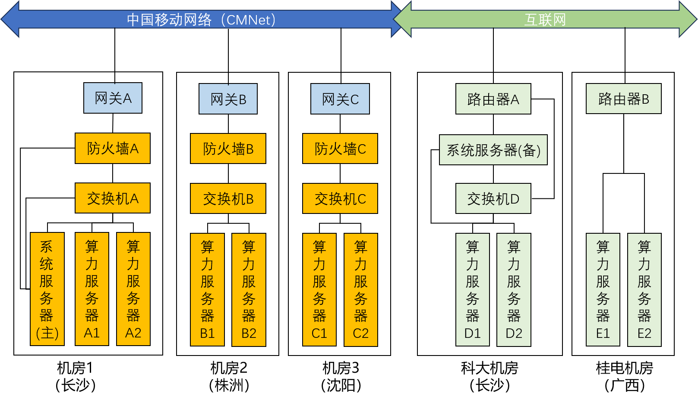
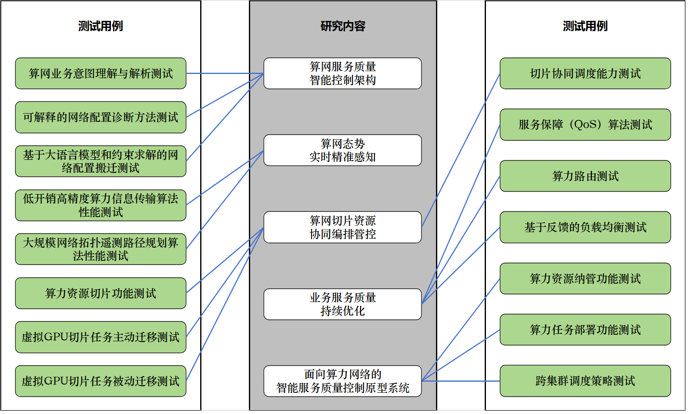

 

# 算力网络智能服务质量控制系统 测试大纲

 

国防科技大学计算机学院

二〇二六年九月

---

## 目录

- [1. 概述](#1-概述)
- [2. 项目背景](#2-项目背景)
  - [2.1. 研究目标](#21-研究目标)
  - [2.2. 研究内容](#22-研究内容)
  - [2.3. 关键技术](#23-关键技术)
- [3. 测试依据](#3-测试依据)
- [4. 测试环境](#4-测试环境)
  - [4.1. 总体环境](#41-总体环境)
  - [4.2. 硬件环境](#42-硬件环境)
  - [4.3. 软件环境](#43-软件环境)
- [5. 测试项说明](#5-测试项说明)
- [6. 测试用例](#6-测试用例)
  - [6.1. 算网业务意图理解与解析测试](#61-算网业务意图理解与解析测试)
  - [6.2. 可解释的网络配置诊断方法测试](#62-可解释的网络配置诊断方法测试)
  - [6.3. 基于大语言模型和约束求解的网络配置搬迁测试](#63-基于大语言模型和约束求解的网络配置搬迁测试)
  - [6.4. 低开销高精度算力信息传输算法性能测试](#64-低开销高精度算力信息传输算法性能测试)
  - [6.5. 大规模网络拓扑遥测路径规划算法性能测试](#65-大规模网络拓扑遥测路径规划算法性能测试)
  - [6.6. 算力资源切片功能测试](#66-算力资源切片功能测试)
  - [6.7. 虚拟GPU切片任务主动迁移测试](#67-虚拟gpu切片任务主动迁移测试)
  - [6.8. 虚拟GPU切片任务被动迁移测试](#68-虚拟gpu切片任务被动迁移测试)
  - [6.9. 切片协同调度能力测试](#69-切片协同调度能力测试)
  - [6.10. 服务保障（QoS）算法测试](#610-服务保障qos算法测试)
  - [6.11. 算力路由优化测试](#611-算力路由优化测试)
  - [6.12. 基于反馈的负载均衡测试](#612-基于反馈的负载均衡测试)
  - [6.13. 算力资源纳管功能测试](#613-算力资源纳管功能测试)
  - [6.14. 算力任务部署功能测试](#614-算力任务部署功能测试)
  - [6.15. 跨集群调度策略测试](#615-跨集群调度策略测试)
- [7. 研究内容与测试用例对照表](#7-研究内容与测试用例对照表)
- [8. 测试记录](#8-测试记录)

## 1. 概述

为有序推进国家自然科学基金项目《面向算力网络的智能服务质量控制架构与关键技术研究》验收阶段测试工作，为本课题验收测试提供全面、系统的工作指引，明确测试各环节工作要求，保障测试过程规范有效，确保测试任务落地实施并达成预期验证目标，特编制本测试大纲。

本文档是算力网络服务质量控制原型系统测试大纲，详细阐述了验收测试的测试依据、测试目的、测试环境、测试项说明、测试用例描述、对照表以及数据记录、整理和分析方法。本文档将作为验收测试策划与测试用例设计的核心依据，对原型系统的功能、性能等维度开展严格测试，全面验证课题成果是否满足项目任务书及相关设计规范要求，保障课题研究目标高质量落地。

## 2. 项目背景

### 2.1. 研究目标

突破面向算力网络的新型服务质量控制统一架构、实时态势精准测量、算网切片协同管控及优化调度、服务质量控制策略持续优化等关键技术，构建算力网络的服务质量控制统一架构，通过建立态势感知、切片编排、QoS策略优化等表征模型，实现意图的获取、转译、验证、执行及反馈闭环；提出面向算力网络状态实时感知的精准测量方法，针对可扩展的算力网络基础行为测量任务，实现算力网络态势高动态、全覆盖精准感知，提出算网切片协同管控及优化调度方法，面向切片的智能化编排任务，实现切片之间的高效协同；提出面向算网切片的服务质量控制策略持续优化方法，面向算力网络全局路由优化及负载均衡需求，实现端到端服务策略的可持续优化；并基于中国移动算力网络创新规模实验网等网络试验平台开展测试验证，为我国算力网络及其关键业务的部署应用奠定理论基础和技术支撑。

### 2.2. 研究内容

#### 2.2.1. 算网服务质量智能控制架构

针对算力网络服务质量控制缺乏统一的表征方法和控制体系，研究算网融合下的新型服务质量控制架构，解决算力网络中的"架构失衡"问题，为算网业务的灵活表示、智能编排和自动配置提供基础。

（1）知识定义的服务质量控制模型

针对算力与网络相互割裂、服务质量难保障等问题，研究如何依据算力与网络的内在联系，设计知识定义的意图驱动服务质量控制架构，实现算网服务质量的灵活控制

（2）算网业务意图理解与解析

针对算力网络存在资源异构、业务多样性等问题，研究如何依据算网业务特性，设计该领域业务意图建模方法，实现算网业务意图的抽象表示和高效映射。

（3）算网业务策略自动配置

针对算力网络存在策略复杂、配置易出错等问题，研究如何依据算网可用资源，设计智能推理求解引擎，实现算网业务策略的智能编排和自动化配置。

#### 2.2.2. 算网态势实时精准感知

针对算网态势精准感知挑战，研究算网态势实时可扩展的联合测量方法，从而实时获取用户业务、虚拟资源以及基础设施等信息，突破算网资源精准实时感知技术，解决算力网络中的"态势失准"问题，为算网资源灵活调度和高效协同提供支撑。围绕如何实现算网态势实时精准感知，本课题拟从以下几个方面开展研究:

（1）算网资源度量标准

设计算网资源度量标准，实现算网资源的统一度量和准确标识，解决算网资源高度异构性问题。

（2）算力资源精准测量

研究算力资源精准测量方法，利用轻量数据结构和深度特征学习理论，解决算力资源信息冗余多样性问题。

（3）网络资源精准感知

研究网络资源实时感知方法，利用新型遥测技术和高效路径规划算法，解决通信资源信息动态多变性问题。

#### 2.2.3. 算网切片资源协同编排管控

针对算网切片竞争共用资源导致切片编排开销过大的问题，研究算网切片智能协同管控，实现算力资源和网络资源一体化优化调度，为实现有效服务质量控制提供必要手段。

（1）资源映射模型

针对算网资源缺乏规范描述、切片资源竞争关系不清晰等问题，研究如何构建算力资源面向虚拟化、云原生容器化演进的度量方法，研究算网业务需求与虚实资源关联机理。

（2）切片动态迁移

针对复杂业务、并发业务需求与静态资源调度不匹配问题，研究如何构造切片与基础资源交互的服务链，设计切片动态迁移策略，实现服务链的部署优化，研究算力资源的动态迁移问题，满足切片的SLA请求。

（3）切片智能协同

针对算网资源动态变化反馈迟滞、算网切片共用资源协同困难等问题，研究如何设计资源需求预测方法，实现算网节点负载状态预测，研究多目标优化模型构建方法，实现切片智能协同。

#### 2.2.4. 业务服务质量持续优化

针对算网切片实时变化导致算网资源动态调度能力不足的问题，研究业务服务质量持续优化技术，适应多样性业务弹性保障需求，为实现有效服务质量控制提供关键支撑。围绕如何实现算网切片的服务质量持续优化，本课题拟从三方面开展研究:

（1）确定性服务服务保障

针对高动态条件下确定性服务性能难扩展问题，研究算网资源联合优化下的网络性能分析方法，提供关键业务确定性服务保障能力。

（2）可扩展算力路由优化

针对算力路由自适应能力不足、资源利用率低的问题，研究如何实现存力、算力、运力相协调的联合优化路由计算，满足算力路由弹性需求。

（3）基于反馈的负载均衡

针对负载均衡算法计算开销大，可扩展性差问题，研究如何基于运行状态反馈支持全局负载均衡，实现基于反馈学习的联合负载均衡，降低反馈所需通信开销和存储开销，保证负载均衡的可靠性及稳定性。

### 2.3. 关键技术

本项目依托四大核心关键技术，从业务意图解析、算网态势感知、资源协同编排、服务质量优化四个维度，构建全流程、智能化、高精度的算网一体化管控体系，全面解决算网异构兼容、配置复杂、感知滞后、资源调度不均、服务质量不稳定等核心问题，具体技术内容如下。

知识定义的意图驱动算网服务质量控制技术是实现算网业务智能化管控的核心基础，核心围绕业务意图规范化解析、智能求解转译、故障诊断与跨厂商适配开展技术研发。该技术自主构建意图专用语言（ISL），能够对各类业务意图进行标准化、规范化定义，可全面覆盖网络连通性、资源隔离性、SLA服务约束等多维度业务诉求，同时兼容轻量化自然语言输入模式，大幅降低业务意图录入与定义门槛。为适配不同网络运维场景需求，搭建“Datalog+SMT求解器”与“Prolog逻辑推理+图模型”双路径智能求解引擎，其中前者主要适配全新空白网络的配置自动生成场景，后者聚焦存量网络的配置迭代优化与精细调优，实现新旧网络场景的全覆盖。依托双路径智能推理求解核心引擎，可完成从高层业务意图到底层网络设备可执行配置的全自动精准转译，摒弃传统人工配置模式，同时具备可解释化网络配置诊断能力，能够精准识别网络路由异常、安全策略漏洞、配置冲突等各类问题，实现故障精准定位与溯源。此外，结合大语言模型与约束求解算法，打造跨厂商设备配置自动化搬迁能力，智能解析、适配不同品牌网络设备的配置语法差异，实现异构设备配置的无缝迁移与统一管控，提升算网系统的兼容性与通用性。

算网态势实时精准感知技术为算网资源调度与质量管控提供精准数据支撑，解决了传统算网感知开销大、精度低、拓扑覆盖不全、资源度量不统一的痛点。技术层面构建动态按需采样机制，打破传统固定频率、固定粒度的采集模式，将整体测量任务按业务粒度拆解为路径分片与内容分片，按需灵活部署测量任务，在保障感知完整性的前提下，大幅降低全网数据采集的资源开销与冗余数据。为优化海量算力数据传输效率，研发低开销高精度算力信息传输算法，引入sketch轻量化数据结构替代传统直接传输模式，在大规模、高并发算力数据采集场景中，有效压缩传输数据体量、降低带宽占用，同时通过数据校准算法保障算力资源各项参数的测量精度，实现开销与精度的双向优化。针对大规模复杂网络拓扑，设计全覆盖遥测路径规划算法，集成INT-Partition、INT-React、INT-Segment、INT-path四类核心算法，可根据网络拓扑结构自动生成最优遥测探测路径，有效减少路径重复探测边数，缩短算法执行耗时，提升大规模网络态势感知的实时性与全面性。同时，建立统一的算网资源度量标准，针对异构服务器的CPU、GPU、内存、存储等算力资源，以及网络链路带宽、时延、抖动等网络资源，制定标准化度量标识与量化规则，有效屏蔽底层硬件、设备的异构差异，为后续资源统一管控、调度提供标准化数据基础。

算网切片资源协同编排管控技术聚焦异构算网资源的统一纳管、量化映射、全生命周期管控与智能调度，实现算网切片资源的高效协同利用。该技术实现多集群算力资源的集中统一纳管，支持多类型服务器集群的无缝接入与一体化管控，可自动识别各节点CPU、GPU、内存、存储等硬件配置信息，支持通过IP地址、主机名等多维度精准检索节点资源，同时实时标记节点正常、告警、故障等运行状态，实现集群节点状态可视化管控。针对CPU、GPU、NPU等多类型异构算力资源，搭建业务需求与虚实资源精准映射模型，设计适配多算力类型的统一量纲映射函数，对异构算力资源进行标准化量化处理，解决异构算力无法统一对比、统一调度的难题，实现全域算力资源的可量化、可管控。构建完善的容器任务全生命周期管理体系，支持Deployment、StatefulSet、Job、CronJob等各类容器任务的模板化批量提交，自动化完成容器镜像拉取、任务部署、实时运行日志采集等操作，同时支持任务暂停、恢复、终止等全流程手动管控，大幅提升容器任务运维效率。基于算网切片服务架构，构建标准化切片服务链，支持切片资源的动态调整与跨节点动态迁移，确保切片业务始终满足既定的SLA服务等级要求，保障切片业务运行稳定性。同时研发多目标跨集群智能调度技术，兼容手动指定集群部署与系统自动择优部署两种工作模式，综合考量集群实时负载率、剩余资源阈值、业务地域就近性、网络时延等多维度核心因子，实现跨集群任务的智能调度与资源均衡分配，有效解决集群资源闲置、负载不均的问题，提升全域算网资源利用率。

业务服务质量持续优化技术面向算网业务全运行周期，通过确定性保障、智能路由优化、动态负载均衡，实现业务QoS的持续迭代优化与稳定运行。在确定性服务保障方面，基于统计网络演算理论构建业务性能分析模型，精准测算端到端业务统计时延边界，能够在网络链路波动、算力资源负载动态变化的复杂场景下，精准预判业务性能波动范围，针对性优化资源分配策略，保障核心关键业务的SLA稳定达标。针对存力、算力、运力协同调度需求，设计可扩展算力路由优化机制，搭建分层马尔可夫决策过程（MDP）模型，通过多层决策迭代求解全局最优路由策略，实现存、算、运三类资源的深度协同与路由路径最优选择，适配多业务、大流量的复杂算网运行场景。依托深度强化学习算法，构建反馈式全局负载均衡体系，实时采集算网系统运行状态、业务运行时延、资源负载等多维数据，形成动态反馈闭环，基于反馈数据迭代优化负载均衡策略，同时优化算法架构，降低反馈数据通信传输与存储开销，实现端到端业务服务质量的动态调优与持续迭代，全方位提升整体算网系统的业务承载能力与服务稳定性。

## 3. 测试依据

本测试大纲依据以下相关文献和标准进行设计，以确保测试的科学性、全面性和可靠性：

《国家自然科学基金资助项目计划书-面向算力网络的智能服务质量控制架构与关键技术研究》

CCSA行业标准：《算力网络 基于态势感知和意图驱动的服务质量控制技术要求》2025-0491T-YD

## 4. 测试环境

### 4.1. 总体环境

本实验环境组网如图 1所示，划分为中国移动CMNet网络与互联网两大互通网络平面，包含长沙机房、株洲机房、沈阳机房、长沙科大机房以及广西桂电机房共五个物理机房站点，其中长沙、株洲、沈阳三处机房经由网关设备接入中国移动CMNet骨干网，科大机房、桂电机房经由互联网接入外部网络；CMNet 专网与互联网两大平面通过运营商互联互通，实现测试环境端到端可达。

长沙机房 1 作为整套环境的控制面核心主站点，部署网关、防火墙与交换机设备，完成机房网络边界防护、路由转发与内网流量汇聚。机房内部核心系统服务器部署算力网络服务质量控制架构原型系统与网络仿真系统，是整套测试环境能力中枢。原型系统负责全局算力态势感知、跨集群任务调度、全域网络服务质量决策；网络仿真系统用于复现真实网络场景，支持内网带宽动态调整、访问策略自定义、端到端 QoS 配置与网络质量仿真验证。该机房算力服务器部署 K8s、Volcano、Karmada、Prometheus 全套技术栈，提供容器资源编排、批量算力任务调度、多集群联邦管理、全维度指标监控。

科大机房与桂电机房作为互联网接入测试站点，分别通过路由器完成公网边界接入，交换机完成服务器内网汇聚。科大机房部署原型系统备份实例；D1、D2 以及桂电机房 E1、E2 算力服务器部署 K8s、Volcano、Karmada、Prometheus 组件，作为公网联邦子集群参与测试。

**图 1 测试总体环境搭建组网图**

从整体分层架构来看，算力层由所有机房算力服务器组成，以K8S为容器运行底座，Prometheus实时采集节点资源、业务运行及网络传输全量指标，Karmada实现五地机房多集群统一联邦治理，Volcano优化算力批量作业调度效率。网络层融合CMNet专网与互联网公网双链路，依托核心部署的网络仿真系统，兼顾了专网精细化带宽调控、策略管控和公网复杂网络环境仿真测试能力，覆盖多样化的算力网络测试场景。平台层以算力网络服务质量控制架构原型系统为核心，部署于长沙机房和科大机房，对接Karmada多集群接口，完成全域算力资源感知、任务分发以及跨专网、公网场景下的网络服务质量控制，整套环境可全面开展专网、公网混合场景下的跨域算力调度、网络服务质量管控等核心测试，满足各类算力网络场景的验证需求。

### 4.2. 硬件环境

本次测试的硬件环境如下表所示：

<b>表 1 硬件环境设备表</b>

| 序号 | 设备分类 | 设备名称 | 配置/型号 | 数量 | 用途 | 备注 |
| :---: | :---: | --- | --- | :---: | --- | --- |
| 1 | 被测载体-算力集群节点 | 算力服务器 | 超聚变2288HV6 Intel 8360Y CPU\*2 512G 浪潮NF5280M6 Intel 8368 CPU\*2 512G | 8 | 算力业务执行节点 | 分布长沙、株洲、沈阳、科大，每机房 2 台 |
| 2 | 被测载体-原型主机 | 系统服务器 | 超聚变2288HV6 Intel 8360Y CPU\*2 512G | 2 | 原型系统部署，一主一备 | 长沙机房主，科大机房备机 |
| 3 | 环境支撑网络设备 | 防火墙 | NSFOCUS NX3、H3C f100-C-A1 | 3 | 机房边界安全防护 | 长沙、株洲、沈阳机房各 1 台 |
| 4 | 环境支撑网络设备 | 交换机 | H3C S5560X-54S-EI | 3 | 内网汇聚交换 | 长沙、株洲、沈阳机房各 1 台 |
| 5 | 测试辅助设备 | 笔记本电脑 | LENOVO 20RD006DCD Intel(R) Core(TM) i7-10710U CPU@1.10GHz(12 CPUs),1.6GHz 16GB | 1 | 测试操作终端 | 远程登录、Web 访问 |

### 4.3. 软件环境

本次测试的软件环境如下表所示：

<b>表 2软件项一览表</b>

| 序号 | 软件名称 | 软件版本 | 部署平台 | 用途 |
| :---: | --- | :---: | --- | --- |
| 1 | 算力网络服务质量控制架构原型系统 | 1.0 | 系统/算力服务器 | 待测软件 |
| 2 | Ubuntu | 多版本 | 系统/算力服务器 | 基础系统环境 |
| 3 | Xshell | 7 | 笔记本电脑 | 服务器远程管理工具 |
| 4 | Tcpdump | 4.9.3 | 系统/算力服务器 | 网络数据包抓取工具 |
| 5 | Tshark | 2.6.10 | 系统/算力服务器 | 网络数据包过滤工具 |
| 6 | Tcpreplay | 4.2.6 | 系统/算力服务器 | 网络数据包重放工具 |
| 7 | 火狐浏览器 | 113.0.2 | 笔记本电脑 | 前端界面访问 |
| 8 | Wireshark | 3.6.7 | 高性能服务器 | 网络数据包抓取工具 |
| 9 | Mininet | 2.2.2 | 高性能服务器 | 测试拓扑构建工具 |

## 5. 测试项说明

本测试大纲围绕算网服务质量智能控制架构、算网态势实时精准感知、算网切片资源协同编排管控、业务服务质量持续优化四大研究内容，以及面向算力网络智能服务质量控制原型系统开展测试验证。测试大纲共设计测试用例15项，覆盖课题全部关键技术方向。

<b>表 3测试项说明</b>

| 序号 | 编号 | 测试用例名称 | 测试目的 | 考核指标 | 对应研究内容 |
| :---: | :---: | --- | --- | --- | --- |
| 1 | —— | —— | —— | 构建知识定义的服务质量控制模型 | 算网服务质量智能控制架构 |
| 2 | 6.1 | 算网业务意图理解与解析测试 | 验证系统解析连通性、隔离性业务意图，自动生成设备配置文件 | 实现算网业务意图理解与解析 | 算网服务质量智能控制架构 |
| 3 | 6.2 | 可解释的网络配置诊断方法测试 | 验证识别路由故障、安全策略缺陷，输出可解释诊断结果 | 完成算网业务策略自动配置 | 算网服务质量智能控制架构 |
| 4 | 6.3 | 基于大语言模型和约束求解的网络配置搬迁测试 | 验证 Cisco/Juniper/Nokia 向华为设备配置自动搬迁，业务功能等价。 | 完成算网业务策略自动配置 | 算网服务质量智能控制架构 |
| 5 | — | —— | —— | 建立算网资源统一度量标准 | 算网态势实时精准感知 |
| 6 | 6.4 | 低开销高精度算力信息传输算法性能测试 | 对比 raw 直接传输与 sketch 传输，验证降低带宽同时保障测量精度 | 实现算力资源精准测量 | 算网态势实时精准感知 |
| 7 | 6.5 | 大规模网络拓扑遥测路径规划算法性能测试 | 验证四类遥测路径规划算法不同拓扑规模下执行时间、路径指标 | 实现网络资源实时精准感知 | 算网态势实时精准感知 |
| 8 | 6.6 | 算力资源切片功能测试 | 验证单 GPU 卡切分，分配给多个业务任务 | 构建算网切片资源映射模型 | 算网切片资源协同编排管控 |
| 9 | 6.7 | 虚拟GPU切片任务主动迁移测试 | 验证 GPU 切片任务手动主动迁移调度能力 | 实现切片动态迁移 | 算网切片资源协同编排管控 |
| 10 | 6.8 | 虚拟GPU切片任务被动迁移测试 | 验证节点故障场景 GPU 切片任务容灾被动迁移能力 | 实现切片动态迁移 | 算网切片资源协同编排管控 |
| 11 | 6.9 | 切片协同调度能力测试 | 验证多 GPU 切片任务跨节点、跨集群协同调度能力 | 实现切片智能协同 | 算网切片资源协同编排管控 |
| 12 | 6.10 | 服务保障（QoS）算法测试 | 验证统计网络演算确定性保障算法，对比 Dijkstra 算法时延边界、SLA 满足率 | 提供确定性服务保障 | 业务服务质量持续优化 |
| 13 | 6.11 | 算力路由优化测试 | 验证系统基于全域算网态势输出全局最优算力路由路径 | 实现可扩展算力路由优化 | 业务服务质量持续优化 |
| 14 | 6.12 | 基于反馈的负载均衡测试 | 验证深度强化学习反馈式负载均衡，降低通信存储开销，优化 QoS | 实现基于反馈的负载均衡 | 业务服务质量持续优化 |
| 15 | 6.13 | 算力资源纳管功能测试 | 验证算力任务下发、部署、运行、日志采集、暂停恢复 | 面向算力网络智能服务质量控制原型系统 | 面向算力网络智能服务质量控制原型系统 |
| 16 | 6.14 | 算力任务部署功能测试 | 验证系统能够算力任务的下发、部署与运行 | 面向算力网络智能服务质量控制原型系统 | 面向算力网络智能服务质量控制原型系统 |
| 17 | 6.15 | 跨集群调度策略测试 | 验证 Web 批量提交任务，自动跨集群负载均衡调度 | 面向算力网络智能服务质量控制原型系统 | 面向算力网络智能服务质量控制原型系统 |

**图 2 研究内容覆盖情况**

## 6. 测试用例

### 6.1. 算网业务意图理解与解析测试

| 项目 | 内容 |
| --- | --- |
| **用例名称** | 算网业务意图理解与解析测试 |
| **测试目的** | 验证原型系统能够解析管理员输入的连通性、隔离性算网业务意图，自动生成符合业务意图的设备配置文件。 |
| **对应考核指标** | 算网业务意图理解与解析 |
| **测试预先条件** | 1、具备描述现网网络拓扑的拓扑文件； 2、具备描述业务连通性、隔离性的意图文件； 3、算力网络智能服务质量控制原型系统正常启动、稳定运行。 |

**测试过程**

| 序号 | 输入及操作说明 | 预期测试结果 | 实际测试结果 |
| :---: | --- | --- | --- |
| 1 | 启动智能算网服务质量控制架构系统 | 页面中显示智能算网服务质量控制架构系统 |  |
| 2 | 选择配置生成模块，上传网络拓扑文件和意图文件 | 页面中正确显示网络拓扑文件和意图文件的具体内容 |  |
| 3 | 点击生成配置，等待一段时间 | 页面出现网络拓扑图 |  |
| 4 | 点击网络拓扑图中任意一个网络设备 | 页面显示该设备对应的具体配置文件 |  |
| 5 | 点击下载配置按钮 | 页面出现下载进度，生成包括全网配置文件的压缩包 |  |
| 6 | 检查网络配置文件是否符合意图文件描述的连通性和隔离性意图 | 网络配置文件符合意图文件描述，生成的网络配置完全匹配业务意图定义的连通性、隔离性约束 |  |

| 项目 | 内容 |
| --- | --- |
| **判定标准** | 所有测试步骤预期结果均达成，生成的网络配置文件完全匹配业务意图定义的连通性、隔离性约束，配置文件可正常下载使用。 |
| **测试结论** |  |
| **测试人员** |  |
| **测试时间** |  |
| **备注** |  |

### 6.2. 可解释的网络配置诊断方法测试

| 项目 | 内容 |
| --- | --- |
| **用例名称** | 可解释的网络配置诊断方法测试 |
| **测试目的** | 验证原型系统是否能够识别网络设备配置中的路由故障、安全策略缺陷，输出可解释的诊断结果。 |
| **对应考核指标** | 网络配置诊断 |
| **测试预先条件** | 1、待验证的全部网络设备配置文件； 2、待校验的网络验证意图文件； 3、算力网络智能服务质量控制原型系统正常启动、稳定运行。 |

**测试过程**

| 序号 | 输入及操作说明 | 预期测试结果 | 实际测试结果 |
| :---: | --- | --- | --- |
| 1 | 启动智能算网服务质量控制架构系统 | 页面中显示智能算网服务质量控制架构系统 |  |
| 2 | 选择配置诊断模块，上传网络设备配置文件和验证意图文件 | 页面中显示文件上传成功 |  |
| 3 | 点击配置诊断，等待一段时间 | 页面出现网络拓扑图 |  |
| 4 | 点击页面中待验证的策略列表中的某一条策略 | 页面显示该策略的验证结果 |  |
| 5 | 点击页面中的全部验证按钮 | 页面显示所有策略的验证结果 |  |
| 6 | 检查验证结果是否正确，即验证结果是否与当前配置文件一致 | 验证结果全部正确，诊断结果与设备实际配置情况完全一致，故障、安全缺陷识别准确 |  |

| 项目 | 内容 |
| --- | --- |
| **判定标准** | 所有策略验证结果正确，诊断结果与设备实际配置情况完全一致，路由故障、安全策略缺陷识别准确，输出可解释诊断报告。 |
| **测试结论** |  |
| **测试人员** |  |
| **测试时间** |  |
| **备注** |  |

### 6.3. 基于大语言模型和约束求解的网络配置搬迁测试

| 项目 | 内容 |
| --- | --- |
| **用例名称** | 基于大语言模型和约束求解的网络配置搬迁测试 |
| **测试目的** | 验证原型系统支持Cisco、Juniper、Nokia设备配置向华为设备配置自动搬迁，搬迁前后网络功能保持一致。 |
| **对应考核指标** | 算网业务策略自动配置 |
| **测试预先条件** | 1、具备Cisco、Juniper、Nokia多份待搬迁配置片段。 2、算力网络智能服务质量控制原型系统正常启动、稳定运行。 |

**测试过程**

| 序号 | 输入及操作说明 | 预期测试结果 | 实际测试结果 |
| :---: | --- | --- | --- |
| 1 | 启动智能算网服务质量控制架构系统 | 页面中显示智能算网服务质量控制架构系统 |  |
| 2 | 选择配置搬迁模块，上传网络设备配置文件 | 页面中显示待搬迁的配置文件片段 |  |
| 3 | 点击配置搬迁按钮，等待一段时间 | 页面中出现对应的华为设备的配置片段 |  |
| 4 | 检查搬迁后结果是否正确，即检查搬迁前后的配置文件片段的功能是否一致 | 搬迁结果正确，搬迁前后网络业务功能完全等价，无业务逻辑丢失、错误 |  |

| 项目 | 内容 |
| --- | --- |
| **判定标准** | 搬迁后华为设备配置功能正确，搬迁前后网络业务功能完全等价，无业务逻辑丢失、错误，配置语法合规。 |
| **测试结论** |  |
| **测试人员** |  |
| **测试时间** |  |
| **备注** |  |

### 6.4. 低开销高精度算力信息传输算法性能测试

| 项目 | 内容 |
| --- | --- |
| **用例名称** | 低开销高精度算力信息传输算法性能测试 |
| **测试目的** | 对比直接传输(raw模式)与sketch低开销传输两种方案，验证新算法在海量算力信息场景下，降低带宽开销同时保证算力测量精度。 |
| **对应考核指标** | 实现算力资源精准测量 |
| **测试预先条件** | 1、测试脚本creat\_data.py、send.py、receive.py部署就绪； 2、算力网络智能服务质量控制原型系统正常启动、稳定运行。 |

**测试过程**

| 序号 | 输入及操作说明 | 预期测试结果 | 实际测试结果 |
| :---: | --- | --- | --- |
| 1 | 运行creat\_data.py以生成海量且不同特征的算力信息 | 在操作目录的data文件夹下成功生成算力信息数据 |  |
| 2 | 打开终端并运行receive.py，设置“mode='raw'” | 终端输出“服务器监听中” |  |
| 3 | 打开另一个终端并运行send.py，设置“mode='raw'” | 该终端输出“成功发送数据”；运行receive.py的终端输出“成功接受数据”；在操作目录的data文件夹下成功生成解析后的算力信息数据 |  |
| 4 | 打开终端并运行receive.py，设置“mode='sketch'” | 终端输出“服务器监听中” |  |
| 5 | 打开另一个终端并运行send.py，设置“mode='sketch'” | 该终端输出“成功发送数据”；运行receive.py的终端输出“成功接受数据”；在操作目录的data文件夹下成功生成解析后的算力信息数据 |  |
| 6 | 打开操作目录的data文件夹下的结果文件，并观察结果 | 算法执行完成，生成分区带宽开销及测量精度结果 |  |

| 项目 | 内容 |
| --- | --- |
| **判定标准** | sketch模式带宽开销较raw模式显著降低（预期降低50%以上），测量精度损失在可接受范围内（预期精度误差≤5%），算法稳定运行无丢包。 |
| **测试结论** |  |
| **测试人员** |  |
| **测试时间** |  |
| **备注** |  |

### 6.5. 大规模网络拓扑遥测路径规划算法性能测试

| 项目 | 内容 |
| --- | --- |
| **用例名称** | 大规模网络拓扑遥测路径规划算法性能测试 |
| **测试目的** | 验证四类遥测路径规划算法在不同规模拓扑下的执行时间、路径指标，评估算法实时性与网络资源占用。 |
| **对应考核指标** | 实现网络资源实时精准感知 |
| **测试预先条件** | 1、具备grid-2d.json拓扑文件，大、中、小规模测试拓扑就绪； 2、算力网络智能服务质量控制原型系统正常启动、稳定运行。 |

**测试过程**

| 序号 | 输入及操作说明 | 预期测试结果 | 实际测试结果 |
| :---: | --- | --- | --- |
| 1 | 在IDEA中启动ComputingNetworkApplication主类，观察控制台日志 | 控制台显示Spring Boot启动成功，监听端口8085，无错误日志 |  |
| 2 | 浏览器访问http://localhost:8085/pages/vis.html | 页面正常加载，显示网络拓扑可视化界面 |  |
| 3 | 点击文件上传按钮，选择INT-partition/grid-2d.json文件 | 文件上传成功，页面显示"初始化"按钮 |  |
| 4 | 点击"初始化"按钮，观察网络图渲染 | 网络拓扑图成功显示，展示节点的2D网格结构，节点与边正常渲染 |  |
| 5 | 记录开始时间，点击运行算法按钮，观察控制台日志 | 开始执行算法 |  |
| 6 | 观察算法执行过程和结果文件 | 算法执行完成，生成分区结果和路径列表 |  |
| 7 | 验证性能指标：查看返回的6项参数数组 | 返回\[最短路径, 最长路径,路径条数,路径方差,算法时间,重复边数\]，数据合理 |  |
| 8 | 观察ECharts性能对比图表 | 6项关键指标数据正常显示，四种算法性能对比清晰可见，柱状图数据准确 |  |
| 9 | 连续执行10次所有算法（四种算法各10次），记录每次执行时间 | 时间波动不超过20%，无性能衰减 |  |
| 10 | 使用小型拓扑（3节点）进行对比测试 | 算法执行时间显著降低（预期小于0.5秒），验证系统在小规模拓扑下的性能 |  |
| 11 | 使用中型拓扑（10节点）进行对比测试 | 算法执行时间显著降低（预期小于0.5秒），验证系统在小规模拓扑下的性能 |  |
| 12 | 打开操作目录的data文件夹下的结果文件，并观察结果 | 算法执行完成，生成分区带宽开销及测量精度结果 |  |

| 项目 | 内容 |
| --- | --- |
| **判定标准** | 四类算法均能正确执行路径规划并输出6项关键指标，算法执行时间满足实时性要求（小规模拓扑&lt;0.5秒），多次执行时间波动不超过20%，无性能衰减。 |
| **测试结论** |  |
| **测试人员** |  |
| **测试时间** |  |
| **备注** |  |

### 6.6. 算力资源切片功能测试

| 项目 | 内容 |
| --- | --- |
| **用例名称** | 算力资源切片功能测试 |
| **测试目的** | 测试原型系统算力资源调度能力，验证是否具备将单张GPU算力卡进行切分并调度给不同任务的能力。 |
| **对应考核指标** | 构建算网切片资源映射模型 |
| **测试预先条件** | 1、集群节点、网络通信正常； 2、算力网络智能服务质量控制原型系统正常启动、稳定运行。 |

**测试过程**

| 序号 | 输入及操作说明 | 预期测试结果 | 实际测试结果 |
| :---: | --- | --- | --- |
| 1 | 浏览器访问系统前端页面 | 成功进入系统界面 |  |
| 2 | 前端界面点击“策略管理-调度策略”选项进入调度策略页面 | 成功进入调度策略页面 |  |
| 3 | 页面中点击新增调度策略按钮，在打开的编辑页面中添加名为“drl-multicast-train-gpushare1”的调度策略配置脚本，点击确定按钮 | 成功创建调度策略，页面列表中正确显示新增策略信息 |  |
| 4 | 前端界面点击“资源管理-工作负载”选项进入工作负载页面，点击“volcano job”选项进入该类型任务的任务管理界面 | 成功进入对应类型任务管理界面 |  |
| 5 | 页面中点击创建按钮，在打开的编辑页面中添加名为“drl-multicast-train-gpushare1”的工作任务脚本，该任务将被随机分配至集群中，并同时运行三个深度强化学习模型训练的pod，最后点击确定按钮 | 成功创建工作任务，页面列表中正确显示新增任务信息，任务状态为显示为“Running” |  |
| 6 | 前端界面点击“集群管理”选项进入集群管理页面，查看各集群节点算力资源使用情况 | 集群管理页面正确显示各集群的GPU资源使用情况 |  |
| 7 | 前端界面右上角选择任务所在集群，进入该集群的管理页面。点击“工作负载-pods”进入pod管理界面 | Pod管理界面显示安排的三个深度强化学习模型训练任务正常运行 |  |
| 8 | 前端界面点击“集群-节点”选项进入节点管理页面，查看集群各节点算力资源使用情况 | 集群节点管理页面正确显示该集群中各节点的GPU资源使用情况 |  |

| 项目 | 内容 |
| --- | --- |
| **判定标准** | 单张GPU卡成功切分并分配给多个业务任务，三个深度强化学习模型训练Pod正常运行，GPU资源使用情况正确显示，无资源冲突或分配错误。 |
| **测试结论** |  |
| **测试人员** |  |
| **测试时间** |  |
| **备注** |  |

### 6.7. 虚拟GPU切片任务主动迁移测试

| 项目 | 内容 |
| --- | --- |
| **用例名称** | 虚拟GPU切片任务主动迁移测试 |
| **测试目的** | 测试原型系统算力资源调度能力，验证是否具备主动迁移调度GPU切片任务的能力。 |
| **对应考核指标** | 实现切片动态迁移 |
| **测试预先条件** | 1、集群节点、网络通信正常； 2、算力网络智能服务质量控制原型系统正常启动、稳定运行。 |

**测试过程**

| 序号 | 输入及操作说明 | 预期测试结果 | 实际测试结果 |
| :---: | --- | --- | --- |
| 1 | 浏览器访问系统前端页面 | 成功进入系统界面 |  |
| 2 | 前端界面点击“策略管理-调度策略”选项进入调度策略页面 | 成功进入调度策略页面 |  |
| 3 | 页面中点击新增调度策略按钮，在打开的编辑页面中添加名为“drl-multicast-train-gpu-migration”的调度策略配置脚本，点击确定按钮 | 成功创建调度策略，页面列表中正确显示新增策略信息 |  |
| 4 | 前端界面点击“资源管理-工作负载”选项进入工作负载页面，点击“volcano job”选项进入该类型任务的任务管理界面 | 成功进入对应类型任务管理界面 |  |
| 5 | 页面中点击创建按钮，在打开的编辑页面中添加名为“drl-multicast-train-gpushare1”的工作任务脚本，该任务将被分配至指定集群中，并同时运行三个深度强化学习模型训练的pod，最后点击确定按钮 | 成功创建工作任务，页面列表中正确显示新增任务信息，任务状态为显示为“Running” |  |
| 6 | 前端界面点击“集群管理”选项进入集群管理页面，查看各集群节点算力资源使用情况 | 集群管理页面正确显示各集群的GPU资源使用情况 |  |
| 7 | 前端界面点击“策略管理-调度策略”选项进入调度策略页面，编辑名为“drl-multicast-train-gpu-migration”的调度策略进行修改，手动指定不同集群，点击确定 | 调度策略修改成功 |  |

| 项目 | 内容 |
| --- | --- |
| **判定标准** | 调度策略修改后，GPU切片任务成功主动迁移至指定集群，任务正常运行无中断，迁移过程对业务无影响 |
| **测试结论** |  |
| **测试人员** |  |
| **测试时间** |  |
| **备注** |  |

### 6.8. 虚拟GPU切片任务被动迁移测试

| 项目 | 内容 |
| --- | --- |
| **用例名称** | 虚拟GPU切片任务被动迁移测试 |
| **测试目的** | 测试原型系统算力资源调度能力，验证是否具备被动迁移调度GPU切片任务的能力（容灾能力）。 |
| **对应考核指标** | 实现切片动态迁移 |
| **测试预先条件** | 1、集群节点、网络通信正常； 2、算力网络智能服务质量控制原型系统正常启动、稳定运行。 |

**测试过程**

| 序号 | 输入及操作说明 | 预期测试结果 | 实际测试结果 |
| :---: | --- | --- | --- |
| 1 | 浏览器访问系统前端页面 | 成功进入系统界面 |  |
| 2 | 前端界面点击“策略管理-调度策略”选项进入调度策略页面 | 成功进入调度策略页面 |  |
| 3 | 页面中点击新增调度策略按钮，在打开的编辑页面中添加名为“drl-multicast-train-gpu-recover-migration”的调度策略配置脚本，点击确定按钮 | 成功创建调度策略，页面列表中正确显示新增策略信息 |  |
| 4 | 前端界面点击“资源管理-工作负载”选项进入工作负载页面，点击“deployment”选项进入该类型任务的任务管理界面，页面中点击创建按钮，在打开的编辑页面中添加名为“drl-multicast-train-gpu-recover-migration”的deployment类型工作任务脚本，最后点击确定按钮 | 成功进入对应类型任务管理界面，deployment类型任务正常创建并显示 |  |
| 5 | Ssh链接服务器，使用Kubectl apply -f命令添加名为“drl-multicast-train-gpu-recover-migration”的ClusterTaintPolicy类型的集群污点策略 | 成功添加ClusterTaintPolicy类型的集群污点策略 |  |
| 6 | 前端界面点击“集群管理”选项进入集群管理页面，查看各集群节点算力资源使用情况 | 集群管理页面正确显示各集群的GPU资源使用情况 |  |
| 7 | 查找任务当前所在集群节点，shutdown命令关闭该服务器，模拟灾害发生，同时在集群管理页面，查看各集群节点算力资源使用情况 | 等待一段时间前端界面正常更新集群节点信息，GPU切片任务被成功调度到正常的集群节点上去 |  |
| 8 | 重启服务器节点模拟灾害恢复，同时在集群管理页面，查看各集群节点算力资源使用情况 | 等待一段时间前端界面正常更新集群节点信息，重启服务器节点正常上线，GPU切片任务所在集群未变，任务正常运行 |  |

| 项目 | 内容 |
| --- | --- |
| **判定标准** | 节点故障后GPU切片任务自动被动迁移至正常集群节点，业务连续运行无中断；节点恢复后任务不回迁，任务状态正常 |
| **测试结论** |  |
| **测试人员** |  |
| **测试时间** |  |
| **备注** |  |

### 6.9. 切片协同调度能力测试

| 项目 | 内容 |
| --- | --- |
| **用例名称** | 切片协同调度能力测试 |
| **测试目的** | 测试原型系统算力资源调度能力，验证是否具备GPU切片协同调度能力。 |
| **对应考核指标** | 实现切片智能协同 |
| **测试预先条件** | 1、集群节点、网络通信正常； 2、算力网络智能服务质量控制原型系统正常启动、稳定运行。 |

**测试过程**

| 序号 | 输入及操作说明 | 预期测试结果 | 实际测试结果 |
| :---: | --- | --- | --- |
| 1 | 浏览器访问系统前端页面 | 成功进入系统界面 |  |
| 2 | 前端界面点击“策略管理-调度策略”选项进入调度策略页面 | 成功进入调度策略页面 |  |
| 3 | 页面中点击新增调度策略按钮，在打开的编辑页面中分别添加名为“drl-multicast-train-gpushare1”到“drl-multicast-train-gpushare5”的五个调度策略配置脚本，点击确定按钮 | 成功创建五个调度策略，页面列表中正确显示新增策略信息 |  |
| 4 | 前端界面点击“资源管理-工作负载”选项进入工作负载页面，点击“volcano job”选项进入该类型任务的任务管理界面，页面中点击创建按钮，在打开的编辑页面中分别添加名为“drl-multicast-train-gpushare1”到“drl-multicast-train-gpushare5”的五个volcano job类型工作任务脚本，最后点击确定按钮 | 成功进入对应类型任务管理界面，五个volcano job类型任务（每个任务有多个独立GPU需求子任务）正常创建并显示 |  |
| 5 | 前端界面点击“集群管理”选项进入集群管理页面，查看各集群节点算力资源使用情况 | 集群管理页面正确显示各集群的GPU资源使用情况，GPU任务被协同调度分配到多个集群中 |  |
| 6 | 前端界面右上角选择任务所在集群，进入该集群的管理页面。点击“工作负载-pods”进入pod管理界面 | 多个集群的多个节点的Pod管理界面正常显示协同调度分配到该节点的GPU切片任务 |  |

| 项目 | 内容 |
| --- | --- |
| **判定标准** | 五个GPU切片任务被协同调度分配到多个集群中正常运行，各集群GPU资源使用情况正确显示，跨节点跨集群协同调度成功 |
| **测试结论** |  |
| **测试人员** |  |
| **测试时间** |  |
| **备注** |  |

### 6.10. 服务保障（QoS）算法测试

| 项目 | 内容 |
| --- | --- |
| **用例名称** | 服务保障（QoS）算法测试 |
| **测试目的** | 验证基于统计网络演算的确定性服务保障算法，在多种随机生成算网拓扑下的QoS保障性能，并与传统Dijkstra最短路径算法开展性能对比，评估在时延边界、SLA满足率、资源开销方面的优劣。 |
| **对应考核指标** | 提供确定性服务保障 |
| **测试预先条件** | 1、集群节点、网络通信正常； 2、网络仿真系统正常启动、稳定运行； 3、算力网络智能服务质量控制原型系统正常启动、稳定运行。 |

**测试过程**

| 序号 | 输入及操作说明 | 预期测试结果 | 实际测试结果 |
| :---: | --- | --- | --- |
| 1 | 登录Web门户 | 登录成功 |  |
| 2 | 调用随机拓扑生成脚本，分别生成小规模、中规模、大规模随机算网拓扑，链路时延、带宽参数随机赋值，保存拓扑文件 | 脚本执行成功，拓扑文件保存成功 |  |
| 3 | 导入业务SLA约束参数，设置业务最大可接受时延阈值 | 参数设置成功 |  |
| 4 | 选择统计网络演算QoS保障算法，依次加载不同规模随机拓扑，执行业务流调度；采集业务端到端时延、SLA满足率、链路资源占用、算法计算耗时 | 算法应用成功，不同测试规模拓扑加载成功，业务执行与调度成功，各种统计信息采集成功 |  |
| 5 | 切换调度算法为Dijkstra最短路径算法，使用同一套随机拓扑、相同业务SLA约束参数，重复执行调度测试，采集相同维度指标 | 算法切换成功，不同测试规模拓扑加载成功，业务执行与调度成功，各种统计信息采集成功 |  |
| 6 | 更换多组不同随机拓扑样本，循环执行测试 | 测试正常执行 |  |
| 7 | 汇总两组算法在各类随机拓扑下的测试数据，开展指标对比分析 | 两种算法均可在各类随机拓扑下完成路径计算；统计网络演算QoS保障算法可输出端到端统计时延，在随机拓扑扰动场景下SLA满足率优于Dijkstra最短路径算法 |  |

| 项目 | 内容 |
| --- | --- |
| **判定标准** | 统计网络演算QoS保障算法在各类随机拓扑下均能正确输出端到端统计时延，SLA满足率优于Dijkstra最短路径算法，算法计算耗时在可接受范围内 |
| **测试结论** |  |
| **测试人员** |  |
| **测试时间** |  |
| **备注** |  |

### 6.11. 算力路由优化测试

| 项目 | 内容 |
| --- | --- |
| **用例名称** | 算力路由优化测试 |
| **测试目的** | 验证原型系统能够根据全域算网态势输出全局最优路由路径 |
| **对应考核指标** | 实现可扩展算力路由优化 |
| **测试预先条件** | 1、集群节点、网络通信正常； 2、网络仿真系统正常启动、稳定运行； 3、算力网络智能服务质量控制原型系统正常启动、稳定运行。 |

**测试过程**

| 序号 | 输入及操作说明 | 预期测试结果 | 实际测试结果 |
| :---: | --- | --- | --- |
| 1 | 登录Web门户，确认态势感知模块已采集各链路时延、带宽、各集群算力负载、存力占用状态 | 信息显示正常 |  |
| 2 | 启用算力路由优化算法 | 算力路由优化算法启动成功 |  |
| 3 | 提交多组业务访问请求，分别指定不同业务优先级、业务数据存取需求 | 请求提交成功，业务按指定需求进行分配 |  |
| 4 | 查看系统输出算力路由计算结果：路由路径、链路占用、业务访问的目标算力节点 | 当链路、算力节点发生拥塞时，路由策略自动切换至更优路径，规避拥塞资源 |  |
| 5 | 修改链路带宽、节点负载，人为制造部分链路/节点拥塞，再次提交相同业务请求，观察路由路径是否动态调整 | 当链路、算力节点发生拥塞时，路由策略自动切换至更优路径，规避拥塞资源 |  |
| 6 | 记录多组业务路由结果，对比路由路径的端到端时延、链路资源开销 | 记录结果显示算力路由优化算法能够稳定分配网络算力资源 |  |

| 项目 | 内容 |
| --- | --- |
| **判定标准** | 系统能基于全域算网态势输出全局最优算力路由路径，链路/节点拥塞时路由策略自动切换至更优路径，端到端时延和资源开销较最短路径算法更优 |
| **测试结论** |  |
| **测试人员** |  |
| **测试时间** |  |
| **备注** |  |

### 6.12. 基于反馈的负载均衡测试

| 项目 | 内容 |
| --- | --- |
| **用例名称** | 基于反馈的负载均衡测试 |
| **测试目的** | 验证基于深度强化学习反馈式负载均衡算法，依托业务运行反馈实现全域算网负载均衡迭代优化，降低通信存储开销 |
| **对应考核指标** | 实现基于反馈的负载均衡 |
| **测试预先条件** | 1、集群节点、网络通信正常； 2、网络仿真系统正常启动、稳定运行； 3、算力网络智能服务质量控制原型系统正常启动、稳定运行。 |

**测试过程**

| 序号 | 输入及操作说明 | 预期测试结果 | 实际测试结果 |
| :---: | --- | --- | --- |
| 1 | 登录Web门户，确认多集群节点全部在线，态势感知模块实时采集各集群CPU、GPU、内存、链路负载指标 | 信息显示正常 |  |
| 2 | 批量下发算力任务，人为造成部分集群高负载，其余集群低负载，形成集群负载不均衡状态 | 集群负载不均衡 |  |
| 3 | 开启反馈式深度强化学习负载均衡算法，算法接收业务运行QoS反馈数据 | 算法可以基于业务运行反馈动态调整任务分配策略 |  |
| 4 | 持续提交新的算力业务任务，观察任务分配结果，跟踪各集群负载变化趋势 | 业务流量变化场景下算法可自适应迭代，保持负载均衡效果 |  |
| 5 | 记录算法迭代过程中集群负载方差、业务端到端QoS指标、算法反馈通信与存储开销 | 相比传统负载均衡策略，反馈通信、存储开销得到控制，业务端到端QoS获得持续优化 |  |

| 项目 | 内容 |
| --- | --- |
| **判定标准** | 反馈式深度强化学习负载均衡算法能基于业务运行反馈动态调整任务分配策略，集群负载方差显著降低，反馈通信与存储开销得到控制 |
| **测试结论** |  |
| **测试人员** |  |
| **测试时间** |  |
| **备注** |  |

### 6.13. 算力资源纳管功能测试

| 项目 | 内容 |
| --- | --- |
| **用例名称** | 算力资源纳管功能测试 |
| **测试目的** | 验证系统能够纳管服务器集群,正确识别硬件资源 |
| **对应考核指标** | 算力网络服务质量控制原型系统 |
| **测试预先条件** | 1、集群节点、网络通信正常； 2、面向算力网络智能服务质量控制原型系统正常启动、稳定运行。 |

**测试过程**

| 序号 | 输入及操作说明 | 预期测试结果 | 实际测试结果 |
| :---: | --- | --- | --- |
| 1 | 输入账号密码登录系统统一Web门户，进入【资源视图】-【全局视图】，查看展示的集群纳管数量、节点总数 | 全局视图准确显示纳管集群数量，节点总数，信息展示无遗漏、无多余、无错误 |  |
| 2 | 依次点击进入各个集群的【集群视图】，逐一核对视图内节点IP、主机名与物理机实际配置信息 | 各集群视图节点列表的IP、主机名与对应物理机实际信息完全匹配，无信息偏差、无识别错误 |  |
| 3 | 随机选择1台节点，点击进入【节点视图】，查看系统识别的CPU核心数、GPU型号/数量、内存总容量、存储总容量等硬件信息，与物理机实际配置比对 | 节点视图展示的所有硬件资源信息与物理机实际配置完全一致，无信息缺失、无识别错误 |  |

| 项目 | 内容 |
| --- | --- |
| **判定标准** | 系统成功纳管4集群，节点IP、主机名、CPU/GPU/内存/存储等硬件信息与物理机实际配置完全一致，节点状态标记正确 |
| **测试结论** |  |
| **测试人员** |  |
| **测试时间** |  |
| **备注** |  |

### 6.14. 算力任务部署功能测试

| 项目 | 内容 |
| --- | --- |
| **用例名称** | 算力任务部署功能测试 |
| **测试目的** | 验证系统支持算力任务的下发、部署与运行。 |
| **对应考核指标** | 算力网络服务质量控制原型系统 |
| **测试预先条件** | 1、集群节点、网络通信正常； 2、算力网络智能服务质量控制原型系统正常启动、稳定运行。 |

**测试过程**

| 序号 | 输入及操作说明 | 预期测试结果 | 实际测试结果 |
| :---: | --- | --- | --- |
| 1 | 输入账号密码登录系统Web门户，进入【任务视图】，点击【批量提交任务】按钮，在任务类型选择框中选择“Job”，在模板选择框中选定已创建的Job任务配置模板 | 可正常选择Job任务类型及配置模板，模板内所有参数完整展示，无参数丢失、乱码、默认值篡改情况 |  |
| 2 | 在节点选择区域，分别选择2个不同集群的各1台节点，确认任务配置后点击【提交】按钮，批量提交2个测试Job任务 | 任务提交过程无弹窗报错，提交成功后系统弹出“提交成功”提示，2个任务均无提交失败情况 |  |
| 3 | 提交完成后，在【任务视图】-【任务列表】中，查看2个测试Job任务的当前状态 | 2个任务的状态均在10秒内切换为“运行中”，无状态延迟更新、状态显示错误或停滞在“待调度”情况 |  |
| 4 | 随机点击1个运行中的测试Job任务，进入【任务详情页】，查看【实时日志】模块的日志采集、更新情况 | 实时日志正常采集，日志按任务执行流程实时更新，内容准确无乱码、无缺失、无重复，日志更新频率与资源采集频率同步 |  |
| 5 | 在该任务详情页，点击【暂停】按钮，执行任务暂停操作，查看任务状态变化 | 暂停操作执行无报错，任务状态在3秒内从“运行中”切换为“暂停”，无操作执行失败、状态不切换情况 |  |
| 6 | 任务处于暂停状态后，在详情页点击【恢复】按钮，执行任务恢复操作，查看任务状态及运行情况 | 恢复操作执行无报错，任务状态在3秒内从“暂停”切回“运行中”，且任务继续按原流程执行，无进程中断、重新执行情况 |  |

| 项目 | 内容 |
| --- | --- |
| **判定标准** | 任务成功下发部署并在10秒内进入"运行中"状态，实时日志正常采集更新，暂停/恢复操作响应时间≤3秒且任务进程不中断。 |
| **测试结论** |  |
| **测试人员** |  |
| **测试时间** |  |
| **备注** |  |

### 6.15. 跨集群调度策略测试

| 项目 | 内容 |
| --- | --- |
| **用例名称** | 跨集群调度策略测试 |
| **测试目的** | 验证Web界面模板批量提交Job任务，任务正常运行，支持实时日志采集，任务暂停、恢复操作 |
| **对应考核指标** | 算力网络服务质量控制原型系统 |
| **测试预先条件** | 1、集群节点、网络通信正常； 2、面向算力网络智能服务质量控制原型系统正常启动、稳定运行。 |

**测试过程**

| 序号 | 输入及操作说明 | 预期测试结果 | 实际测试结果 |
| :---: | --- | --- | --- |
| 1 | 输入账号密码登录系统Web门户，进入【系统配置】-【跨集群调度配置】模块，查看跨集群调度策略模式及资源匹配度阈值设置 | 跨集群调度策略模式为“集群负载均衡”，资源匹配度阈值为 “剩余资源≥20%”，策略状态为“已启用”，配置信息可正常查看，无修改异常、配置失效情况 |  |
| 2 | 返回【任务视图】，点击【提交任务】按钮，任务类型选择“StatefulSet”，按预设配置填写任务资源需求（CPU 2核、GPU 1卡），调度模式选择“自动选择集群”，不指定目标集群，确认后点击【提交】按钮 | 任务提交过程无弹窗报错，提交成功后系统弹出“提交完成”提示，任务进入“待调度”状态，无提交失败情况 |  |
| 3 | 提交完成后，在【任务列表】中查看该测试任务的【所属集群】字段，同时核对该集群的CPU/GPU利用率、剩余资源数据 | 任务自动调度至集群1或集群3，目标集群的CPU/GPU利用率≤60%且剩余资源≥20%，完全匹配调度策略要求 |  |
| 4 | 按步骤2的相同配置，再次提交2个同规格的StatefulSet测试任务，调度模式均选择“自动选择集群”，查看2个任务的【所属集群】字段 | 2个任务均调度至集群1或集群3，无任何任务调度至集群2或集群4；3个测试任务在集群1和集群3间合理分配，实现集群负载均衡效果 |  |
| 5 | 在【任务列表】中查看3个已调度完成的测试任务的当前状态 | 3个任务的状态均在10秒内从“待调度”切换为“运行中”，无因调度策略匹配错误导致的任务启动失败、状态异常或停滞情况 |  |

| 项目 | 内容 |
| --- | --- |
| **判定标准** | 任务按集群负载均衡策略自动调度至资源充足的集群（CPU/GPU利用率≤60%且剩余资源≥20%），多任务合理分配实现负载均衡，任务均在10秒内进入运行中状态 |
| **测试结论** |  |
| **测试人员** |  |
| **测试时间** |  |
| **备注** |  |

## 7. 研究内容与测试用例对照表

<b>表 4 研究内容与测试用例对照表</b>

| 序号 | 考核指标 指标名称 | 考核指标 完成时指标/状态 | 对应的测试用例 |
| :---: | --- | :---: | :---: |
| 1 | 构建知识定义的服务质量控制模型 | 完成 | —— |
| 2 | 实现算网业务意图理解与解析 | 完成 | 6.1 |
| 3 | 完成算网业务策略自动配置 | 完成 | 6.2、6.3 |
| 4 | 建立算网资源统一度量标准 | 完成 | —— |
| 5 | 实现算力资源精准测量 | 完成 | 6.4 |
| 6 | 实现网络资源实时精准感知 | 完成 | 6.5 |
| 7 | 构建算网切片资源映射模型 | 完成 | 6.6 |
| 8 | 实现切片动态迁移 | 完成 | 6.7、6.8 |
| 9 | 实现切片智能协同 | 完成 | 6.9 |
| 10 | 提供确定性服务保障 | 完成 | 6.10 |
| 11 | 实现可扩展算力路由优化 | 完成 | 6.11 |
| 12 | 实现基于反馈的负载均衡 | 完成 | 6.12 |
| 13 | 面向算力网络智能服务质量控制原型系统 | 完成 | 6.13、6.14、6.15 |

## 8. 测试记录

<b>表 5 测试记录表</b>

| 序号 | 对应章节 | 测试用例 | 测试结果 | 测试结论 合格 | 测试结论 不合格 |
| :---: | :---: | --- | :---: | :---: | :---: |
| 1 | 6.1 | 算网业务意图理解与解析测试 |  |  |  |
| 2 | 6.2 | 可解释的网络配置诊断方法测试 |  |  |  |
| 3 | 6.3 | 基于大语言模型和约束求解的网络配置搬迁测试 |  |  |  |
| 4 | 6.4 | 低开销高精度算力信息传输算法性能测试 |  |  |  |
| 5 | 6.5 | 大规模网络拓扑遥测路径规划算法性能测试 |  |  |  |
| 6 | 6.6 | 算力资源切片功能测试 |  |  |  |
| 7 | 6.7 | 虚拟GPU切片任务主动迁移测试 |  |  |  |
| 8 | 6.8 | 虚拟GPU切片任务被动迁移测试 |  |  |  |
| 9 | 6.9 | 切片协同调度能力测试 |  |  |  |
| 10 | 6.10 | 服务保障（QoS）算法测试 |  |  |  |
| 11 | 6.11 | 算力路由优化测试 |  |  |  |
| 12 | 6.12 | 基于反馈的负载均衡测试 |  |  |  |
| 13 | 6.13 | 算力资源纳管功能测试 |  |  |  |
| 14 | 6.14 | 算力任务部署功能测试 |  |  |  |
| 15 | 6.15 | 跨集群调度策略测试 |  |  |  |
